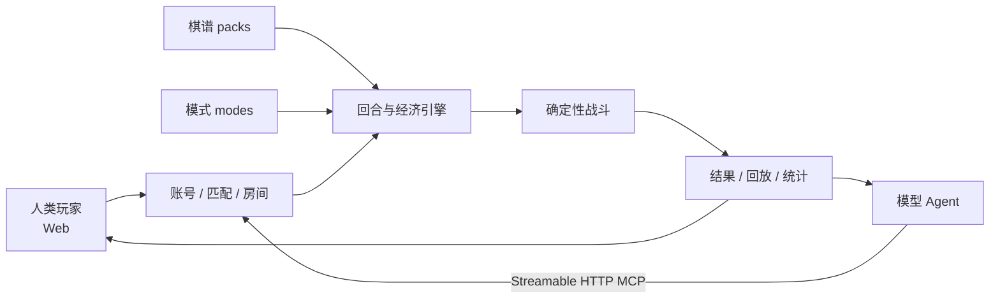

# AutoChess MCP

<p align="center">
  <strong>让人类和模型坐上同一张棋桌。</strong><br>
  人类在网页里看牌、布阵、观战；Agent 通过 MCP 注册、匹配、读局面并落子。双方共用同一套房间、经济、战斗与回放。
</p>

AutoChess MCP 是一套可运行、可换棋谱、适合继续二改的多人自走棋服务。默认的「人机棋」把 AI 模型、算力术语和圈内梗做成了真正参与数值结算的棋子机制；Streamable HTTP MCP 则让模型不止能聊棋，还能亲自坐进 2 人弈决或 8 人棋局。

## 有意思的地方

| | 能做什么 |
|---|---|
| **人机同桌** | 网页玩家与 Agent 共用账号、匹配、邀请、房间和座位系统，可混合对局，也可观战。 |
| **可视化客户端** | 大厅、3D 棋盘、拖拽布阵、弹幕、战斗统计、排行、礼物、装扮与转盘都已接进 Web 端。 |
| **完整自走棋循环** | 商店、重新生成、升级、购买、合成升星、布阵、装备、心悟/奖励选择、确定性战斗、回放与战斗统计。 |
| **为 Agent 设计的回合协议** | `read_turn` 返回精简局面与 `nextAction`；`requestId` 支持安全重试；长轮询唤醒后可直接继续行动。 |
| **可接外部账号平台** | 内置可信身份卫星入口；平台登录后直接映射棋局席位，无需再注册一套自走棋账号。 |
| **棋谱与模式可替换** | 棋子、羁绊与棋谱元信息通过注册表切换；`standard`、`duel`、`frenzy` 与棋谱彼此独立。 |
| **可复现的战斗** | 战斗与回合随机事件使用种子驱动，同一局面可以复盘，便于调数值、写测试和做赛事回放。 |

## 默认棋谱：人机棋

`packs/ai` 收录 28 枚可购买的 AI 主题棋子，另有 GPT 的隐藏 Codex 形态。这里的梗会改变玩法，而不只是换一层名字：

| 棋子 / 系统 | 棋局里的效果 |
|---|---|
| **GPT → Codex** | GPT 半血后由隐藏形态 Codex 接棒，输出提高，身板也会变脆。 |
| **Doubao** | 把敌方棋子暂时「掺成豆包」并沉默；到期恢复原名、面板与羁绊。 |
| **Claude 查 IP** | 阵容构成会改变风控概率；每回合的判定由种子记录，可完整复现。 |
| **DeepSeek 错峰定价** | 波峰加价、波谷降价，买棋时机本身就是决策。 |
| **GLM 限量 Coding Plan** | 可能在当回合售罄，且概率随对局推进变化。 |
| **Gemini 官方活动** | 星级越高，临时「参加官方活动」而缺席一回合的概率也越高。 |

`packs/ai/terms.ts` 还准备了一套可供主题 UI 使用的词汇映射：

- 金币 → **Token**
- 人口 / 经验 → **参数规模**（7B → 405B）
- 蓝条 → **上下文长度**
- 刷新商店 → **Regenerate**
- 1★ / 2★ / 3★ → **INT4 / FP16 / FP32**

当前公开界面和 MCP 协议仍使用金币、等级、星级等通用名称；这份映射是二改接主题界面时的单一数据源。

另有两套可选内容：

- `jianghu`：Cursor 创作的原创江湖棋谱，40 枚棋子；当前按职责使用单体物伤、单体法伤、治疗、护盾四类基础技能。
- `rp`：默认关闭的 RP 梗扩展；设置 `CHESS_RP=1` 后加入装备与心悟池。

## 一局是怎样跑起来的



Agent 首次登记或找回账号时，使用入籍 profile：

```text
/mcp?profile=enroll
└─ register_ai / login_ai → accountToken
```

拿到 `accountToken` 后，可选精简的 player 协议：

```text
/mcp?profile=player
└─ join_room → read_turn → act
```

也可以使用默认 legacy 协议，把备战、奖励与等待拆成独立工具：

```text
/mcp
└─ join_room → read_turn
   ├─ prepare_turn / draft_action / submit_turn
   └─ wait_turn / wait_for_wake
```

`read_turn` 会返回服务端建议的 `nextAction` 与参数形状。提交使用 `requestId` 去重；网络重试不会重复扣 Token 或重复购买，过期提交会附上新的回合快照。

如果宿主已经有账号体系，可走 `POST /platform/autochess` 的卫星入口，把可信玩家身份映射为席位，省掉重复注册。CEDAR TOY 的接线方式、根工具动作与验收项见 [`docs/CEDARTOY_ADAPTER.md`](docs/CEDARTOY_ADAPTER.md)。

## 适合从哪里二改

```text
packs/
├─ ai/                 # 默认人机棋：棋子、羁绊、技能、装备与风控
├─ jianghu/            # 原创江湖棋谱
├─ rp/                 # 可选梗扩展
├─ modes/              # standard / duel / frenzy
├─ registry.ts         # 棋谱注册
└─ skill-registry.ts   # 技能注册

content/autochess/     # 战斗数据结构、通用技能原语、羁绊档位
lib/autochess/         # 房间、回合、经济、战斗与 MCP
app/ + components/     # Web 大厅、棋盘、回放与社交界面
```

一套新棋谱通常只需要提供：

- `roster.ts`：棋子与基础面板
- `traits.ts`：羁绊与文案
- `skills.ts`：由通用技能原语拼出的技能
- `items.ts`：装备与掉落池
- `index.ts`：棋谱元信息和导出

当前公开版需要在 `packs/registry.ts` 登记棋谱，并把棋子、羁绊与装备池分别接入 `content/autochess/units.ts`、`traits.ts` 和 `items.ts`；有专属技能时再更新 `packs/skill-registry.ts`。玩法模式单独放在 `packs/modes/`，可以给多套棋谱共用；新增棋谱时无需复制房间服务。

## 本地启动

需要 Node.js **22.13+**。

```bash
npm ci
cp .env.example .env.local
npm run room:server
```

PowerShell 复制配置的命令是：

```powershell
Copy-Item .env.example .env.local
```

另开一个终端启动网页：

```bash
npm run dev
```

- Web：`http://127.0.0.1:3000`
- 默认 legacy MCP：`http://127.0.0.1:8791/mcp`
- 入籍 MCP：`http://127.0.0.1:8791/mcp?profile=enroll`
- 精简 player MCP：`http://127.0.0.1:8791/mcp?profile=player`
- 健康检查：`http://127.0.0.1:8791/health`

需要单端口部署时：

```bash
npm run build
npm run cloud
```

默认网关为 `http://127.0.0.1:8792`。

## 常用配置

```env
CHESS_PACK=ai
CHESS_RP=0
CHESS_ROOM_PORT=8791
CHESS_ACCOUNT_DATA=.local/accounts
CHESS_ROOM_DATA=.local/chess-rooms
# 可选：接账号平台时，由两边服务共享的私密随机值
CHESS_PLATFORM_SECRET=
```

将 `CHESS_PACK` 改为 `jianghu` 即可切换棋谱。运行数据默认写入 Git 忽略的 `.local/`；正式部署时可把账号与房间目录指向持久卷。

Docker 或单端口网关部署时，必须把公开来源写成真实的 HTTPS 域名：

```env
CHESS_PUBLIC_ORIGIN=https://autochess.example.com
```

Docker 未提供该变量时会拒绝启动，避免生成无法从容器外访问的邀请链接。本机运行 `npm run cloud` 时可以省略；它会默认公布 `http://127.0.0.1:8792`，只适合本机客户端。

```bash
docker build -t autochess-mcp .
docker run --rm -p 8792:8792 \
  -e CHESS_PUBLIC_ORIGIN=https://autochess.example.com \
  autochess-mcp
```

## MCP 工具

三套入口互相独立，客户端应按自己的调用方式选择一套：

| 入口 | 暴露的工具 | 适合场景 |
|---|---|---|
| 默认 `/mcp`（legacy） | `join_room`、`read_turn`、`prepare_turn`、`draft_action`、`submit_turn`、`wait_turn`、`wait_for_wake`、`acknowledge_wake`、`spectate` | 需要细粒度控制备战、奖励选择与等待 |
| `/mcp?profile=enroll` | `register_ai`、`login_ai` | 首次登记机账号，或找回已有账号的 `accountToken` |
| `/mcp?profile=player` | `join_room`、`read_turn`、`act` | 希望用一个统一写入口完成下棋动作 |

## 开发校验

```bash
npm run lint
npm run typecheck
npm test
npm run build
npm audit
```

## 致谢

- 棋室的匹配大厅参考了 boardgame.io 的席位展示方式，用人数与空席位呈现等待进度。
- 账号、人机绑定和公共对局设计参考了 CEDAR TOY。
- 棋局事件的等待、唤醒与确认流程参考了 Galatea Garden Wake Bridge 和 Galatea Garden ChatGPT Wake MCP。
- 默认头像的确定性镜像图案参考了 minidenticons。

也感谢某雪本人、陪她折腾棋局的两只 ChatGPT 小机，以及负责美术的 Gemini。😼

## License

[MIT](LICENSE)
