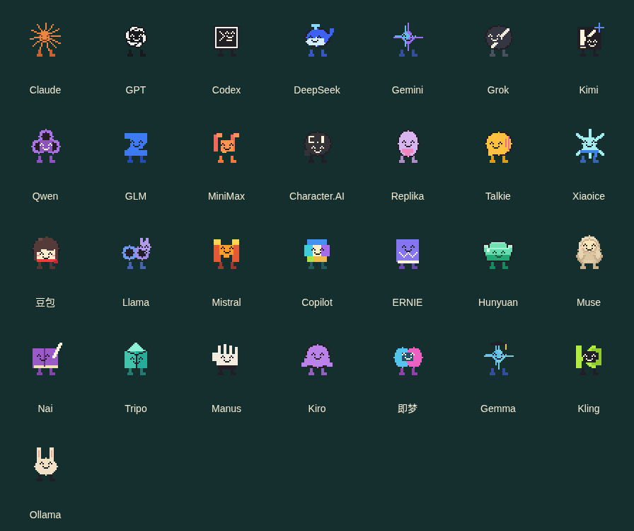

# 人机棋像素角色素材

29 个角色（含隐藏 Codex），24×24 基础像素网格，透明 PNG。Muse 已改为用户参考图中的米色毛绒豆子：浅奶油脸、两条短脚、双手空着，没有红心或道具。保留内部 ID `ai-musespark`。

新增：按角色主色绘制的普攻和按棋谱技能设计的特效，详见 [普攻与技能接入说明](EFFECTS.md)。Claude 为橘色，GPT / Codex 为黑白；技能名称与 `packs/ai/skills.ts` 对齐。

已补齐当前 AI 技能表的被动钩子、受击触发、条件救场、阵亡传火、追加攻击及四类角色风控事件，另有全角色共用状态动画。见 [被动与事件接入说明](EVENTS.md)。预览新增事件选择、循环和全角色轮播。



## 给接入端的说明

这次提交只增加素材包，没有修改棋谱、战斗结算、技能或现有 Web 客户端。直接读取 [manifest.json](manifest.json) 的 ID、帧坐标和时长即可；也可以加载两个独立绘制脚本。`preview/motion.js` 的木桩伤害和时间轴只是演示，不能作为正式战斗逻辑。

| 文件 | 用途 |
| --- | --- |
| `portraits/ai-*.png` | 29 张 64×64 透明立绘，已带表情与双脚 |
| `atlases/ai-*.png` | 每角色一张 512×1088 图集；17 段动画，共 77 帧 |
| `manifest.json` | 角色 ID、显示名、锚点、每帧矩形、持续时间和循环设置 |
| `effects/bubble.png` | 独立透明泡泡壳，与角色使用相同锚点 |
| `preview/mascots.js` | 24×24 身体绘制源码、颜色与脸部位置 |
| `preview/renderer.js` | 不依赖预览页面或战斗状态的绘制 API |
| `preview/index.html` | 可直接打开的完整动作演示 |
| `preview/effects.js` | 独立普攻、像素弹道、斩击、冲击与主色配置 |
| `preview/skills.js` | 28 个主动技能的视觉编排及 Codex 被动换形展示 |
| `preview/motion.js` | 预览控制器；技能分支与辅助木桩场景 |

## 最小接入

1. 按原棋子 ID 取素材，例如 `ai-doubao`、`ai-gpt`、`ai-musespark`。Codex 使用 `ai-codex`，仍由现有 GPT 换形事件控制。
2. HP 百分比大于 50 用 `happy`，21～50 用 `serious`，1～20 用 `cry`，0 用 `dead`。刚从大于 50 降到 21～50 时，临时播放 650 ms 的 `shock`，之后恢复当前血量表情；不要每次重绘都重启吃惊。
3. 组合表情和动作，例如 `happy/walk`、`cry/attack`。根据正式游戏事件播放攻击或受击；动画本身不能扣血。攻击动作总长 850 ms，示例打点在 420 ms；接入端应以真实战斗事件为准，可以按正式攻击节奏调整播放速率。
4. 每帧为 64×64；落脚点锚点为 `(32,40)`。角色的逻辑网格位于帧内 `(20,16)`，留白用于倾斜、倒下和漫画惊讶特效。使用整数倍缩放与 nearest-neighbor，关闭平滑采样。图集每段一行，未使用的尾部格子为空，不属于动画。
5. `shock/*` 帧已经包括局部漫画放射线、叹号和汗滴。GPT 泡泡壳独立叠加，以正式护盾状态驱动；图集没有烘焙护盾，避免它一直存在。

角色 PNG 的攻击帧包含蓄力、前冲和收回；独立普攻特效位于 `effects/attacks/`，技能基础特效和状态标记位于 `effects/` 与 `effects/symbols/`，坐标由正式战斗事件提供。角色 `previewRole` 只供演示，不替代棋谱的实际职责和技能。

## Muse 替换约定

- 显示名和形象：`Muse`，米色毛绒豆子，空手。
- 素材文件和内部键：继续使用 `ai-musespark` / `musespark`，不新增单位、不迁移存档、不改技能键。
- 接入游戏时，修改 `packs/ai/roster.ts` 该棋子的两处展示文案 `Muse Spark` → `Muse`；保留所有 `ai-musespark` 字符串和数值。同步 `packs/ai/README.md` 的展示名即可。本提交尚未改这些游戏文件。
- 查询了 [Muse 官方介绍](https://muse.ai/blog/how-we-designed-muse) 和 [Meta 发布说明](https://about.fb.com/news/2026/09/introducing-muse-personal-ai-agent/)。官方蓝色手写 m 是产品标志；本素材按用户提供的内部角色参考图绘制，**没有采用蓝色标志，也没有参考图手中的红心**。

## 直接用绘制源码

按顺序加载 `mascots.js`、`renderer.js`，无需 `motion.js` 或预览 DOM：

```html
<script src="preview/mascots.js"></script>
<script src="preview/renderer.js"></script>
```

```js
PixelMascots.draw(ctx, 'ai-musespark', {
  x: 20, y: 16, scale: 4, timeMs: visualClockMs,
  hp: 50, action: 'walk', // hp 为 0～100 百分比；action 为 idle 或 walk
  attackAgeMs: 9999,     // 攻击开始后的毫秒数，默认 9999 表示无攻击
  hitAgeMs: 9999,        // 受击开始后的毫秒数
  shockAgeMs: 120,       // 吃惊开始后的毫秒数；默认 9999 表示无吃惊
  shockDurationMs: 650,
  reducedMotion: false, effects: true, shield: false
});
```

`x/y` 是身体网格左上角，不是落脚点。屏幕落脚点为 `(x + 12*scale, y + 24*scale)`。API 不改变血量、棋子位置、时钟或战斗状态；接入端每帧先清理自己的绘制区域。镜像朝向由调用端的 canvas transform 处理。

## 重导出和检查

在本目录运行 `npm install`，再运行 `npx playwright install chromium`（已有 Chromium 可设置 `CHROMIUM_PATH`）。然后：

```sh
npm run export
npm run validate
npm run check
```

导出器只加载画图源码，没有启动游戏或模拟结算。检查覆盖 roster ID、透明图集大小、帧边界和动画内容，以及预览里的血量表情切换、单次攻击打点、阵亡复活、走路、手机布局。

## 已定稿的外观细节

- 所有角色两条短脚。Claude 为橙色放射花形；GPT 黑白编织体、无外圈白边，泡泡壳独立；Codex 黑色终端、白色提示符。
- 豆包红围巾、棕色头发和棕色脚，无发卡、无蓝脚。
- 混元是横向玉绿色元宝；Muse 米色毛绒轮廓、空手。
- 吃惊为深色眼框与白色眼心，配局部漫画动作。

GPT 的编织轮廓参考 [Lobe Icons 的 OpenAI 图形](https://github.com/lobehub/lobe-icons/blob/master/packages/static-svg/icons/openai.svg)，在低分辨率网格上重绘；其余角色沿用本轮已确认的程序像素设计。此包的 PNG 是绘制源码实际导出的游戏素材，早期概念大图不作为切帧源。
